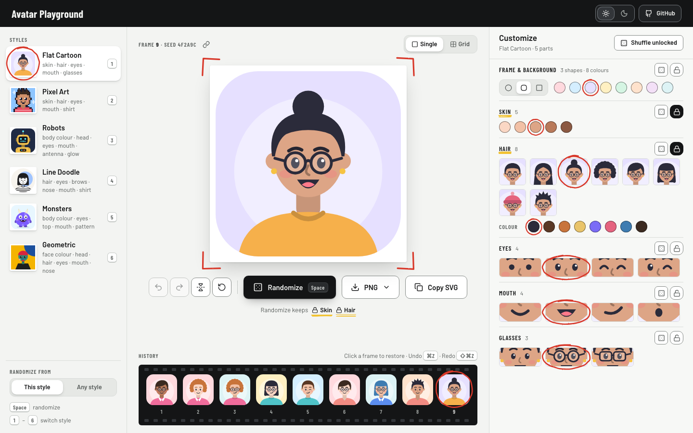

# Avatar Playground

Make an avatar in one of six styles: roll random ones, tweak any part, lock what you like so further rolls keep it, then download a PNG or SVG, or share a link that recreates the exact avatar. Runs entirely in the browser: no account, no server, no tracking.



## Features

- **Six styles:** Flat Cartoon, Pixel Art, Robots, Line Doodle, Monsters, Geometric.
- **Randomize with control:** roll within the style or across any style; lock parts so rolls keep them; roll a single part; "Shuffle unlocked".
- **Options previewed on your avatar:** every tile shows your current avatar with that one option, cropped to the part.
- **Grid view:** a contact sheet of twelve rolls that all keep your locks; pick one and keep it.
- **History:** a film strip of your rolls; click a frame to restore it; undo and redo (50 steps).
- **Share links:** the URL describes the avatar exactly, so a link opens the same avatar anywhere.
- **Export:** PNG at 256, 512 or 1024 px (Pixel Art 200 to 1000, so pixels stay whole), optionally with a transparent background; SVG download; Copy SVG.
- **Light and dark**, following your system unless you choose.
- **Keyboard and screen reader friendly:** everything works from the keyboard; swatches have colour names; each new frame is announced with what it shows.

### Keyboard

| Key                               | Does                                       |
| --------------------------------- | ------------------------------------------ |
| `Space`                           | Randomize (in Grid view: roll a new sheet) |
| `1`–`6`                           | Switch style                               |
| `⌘Z` / `Ctrl+Z`                   | Undo                                       |
| `⇧⌘Z` / `Ctrl+Shift+Z` / `Ctrl+Y` | Redo                                       |
| Arrow keys                        | Move between options in a group of tiles   |

`Space` leaves a focused button alone (it presses the button), and no shortcut fires while you type or a menu is open.

## Run it

Requires Node 20.9 or newer (developed on 24) and Python 3 (for `pnpm start`). pnpm comes from corepack: run `corepack enable` once, or prefix commands with `corepack`.

```sh
pnpm install
pnpm dev                 # http://127.0.0.1:3001
```

| Command         | What it does                                                      |
| --------------- | ----------------------------------------------------------------- |
| `pnpm dev`      | Dev server on http://127.0.0.1:3001 (loopback only)               |
| `pnpm build`    | Static export to `out/`                                           |
| `pnpm start`    | Serves `out/` from a plain static server on http://127.0.0.1:3001 |
| `pnpm check`    | Lint, unit tests and the production build                         |
| `pnpm test`     | Unit tests (Vitest)                                               |
| `pnpm test:e2e` | Browser tests (Playwright) against `out/`; run `pnpm build` first |
| `pnpm format`   | Prettier with Tailwind class sorting (`format:check` to verify)   |

The first `pnpm test:e2e` needs Playwright's browsers: `pnpm exec playwright install chromium firefox webkit`.

## Deploy

The build is a static site: upload `out/` to any static host (GitHub Pages, Netlify, Cloudflare Pages, S3, Vercel). Two notes:

- Set `SITE_URL` when building, so share cards point at your address: `SITE_URL=https://avatars.example.com pnpm build`.
- Serve it compressed (gzip or brotli). Every common host does this by default; it roughly halves the download.

Lighthouse on the static build: accessibility 100, best practices 100, SEO 100; performance 100 on desktop and 93 on mobile.

## How it works

- **Engine** (`src/engine/`): each style is one file that declares its options and palettes, a zod schema, `random(rng, keep)` and a pure `render(config)` that returns a 200×200 SVG string. All randomness is decided in `random` and stored in the config (hand-drawn wobble is a stored seed), so a config always draws the same avatar. Options are string IDs and colours come from each style's palette.
- **State** (`src/store/`): one zustand store with per-style memory (film, undo history, locks, frame shape, Grid sheet). Locks are saved in `localStorage`; nothing else is stored.
- **Share link:** `?s=<style>&v=1&c=<base64url JSON config>`, plus `f=<frame shape>` and `m=1` (flipped) when they differ from the defaults. Links are checked before anything is drawn: the style and version must be known, and the style's strict schema must accept the config. A bad link falls back to a fresh avatar with a notice.
- **Export:** the PNG is the avatar's own SVG drawn onto a canvas at the chosen size; the SVG is self-contained.
- **UI:** Next.js 16 (App Router, static export), React 19, Tailwind v4, shadcn/ui on Base UI. The visual system is the "Contact Sheet" in [`DESIGN.md`](DESIGN.md); product context is in [`PRODUCT.md`](PRODUCT.md).

## Tests

- **Unit** (`src/**/*.test.ts`): engine determinism, every option rendered as valid XML, 1,000 fuzzed configs per style, lock invariants, schema rejection of foreign values and injection strings, parity with the original prototype (`prototype/generate.mjs`), the store, share links, export and the screen-reader wording.
- **Browser** (`e2e/`): rolls and locks, undo and history, share links (including malicious ones), export in Chromium, Firefox and WebKit, an axe accessibility audit of every screen, a keyboard-only pass, the static-hosting check, and visual baselines (6 styles × light and dark × desktop and phone).

Visual baselines are recorded on macOS. After an intended visual change, refresh them with `pnpm test:e2e e2e/visual.spec.ts --update-snapshots` and review the diff.

## Project layout

```
src/app/            layout, page, icon.svg, apple-icon.png and opengraph-image.png (generated at build)
src/components/     playground (rail, stage, film strip, customize panel), pencil marks, shell, ui (shadcn)
src/content/        the six styles' parts: titles, crops, labels, default locks
src/engine/         the avatar engine (pure TypeScript, no React)
src/store/          state, boot, share links, saved locks
src/lib/            render cache, motion, export, screen-reader descriptions
e2e/                Playwright tests and visual baselines
assets/fonts/       Barlow, for the share card (SIL Open Font License, see OFL.txt)
prototype/          the original engine prototype (kept for the parity test)
```

Adding a shadcn component: `pnpm dlx shadcn@latest add <name>`, then `pnpm lint --fix && pnpm format` (the ESLint rules turn its `function` components into arrow functions).

## Credits

Made by Boyan Liu. Fonts: [Barlow](https://github.com/jpt/barlow) by Jeremy Tribby, SIL Open Font License 1.1. No license has been chosen for the code yet.
